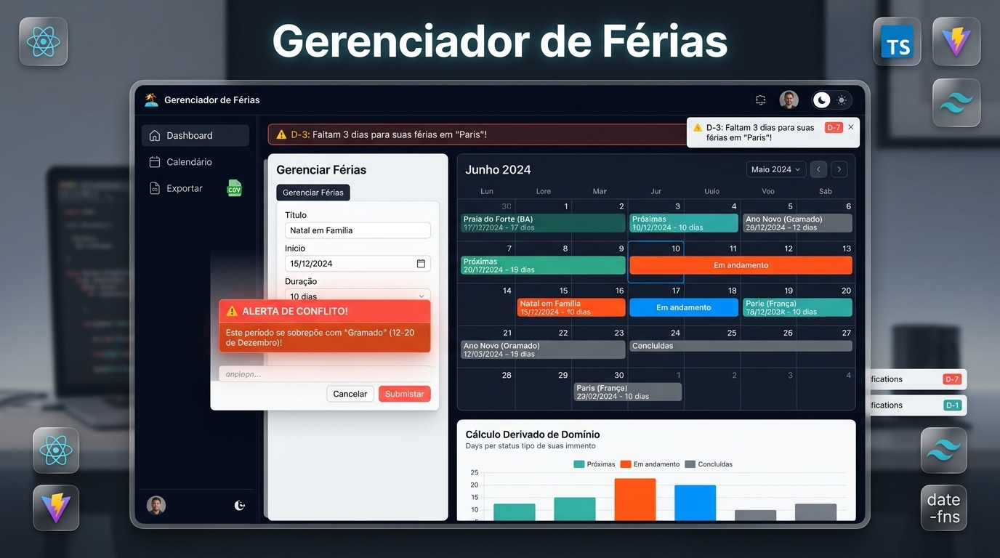

# 🏖️ Gerenciador de Férias

[](https://github.com/leonardoconstantino/gerenciador-ferias/actions/workflows/deploy.yml)


> Aplicação SPA offline-first para planejar e gerenciar períodos de férias pessoais, com detecção inteligente de conflitos de datas, alertas automáticos de proximidade, calendário mensal interativo e exportação em CSV compatível com Excel.

🚀 **Acesse a aplicação online:**  
👉 **[https://leonardoconstantino.github.io/gerenciador-ferias/](https://leonardoconstantino.github.io/gerenciador-ferias/)**

---

## 📸 Demonstração

<!-- Bloco reservado para Hero Image -->
<p align="center">
  
</p>

---

## ✨ Principais Recursos

- 🔒 **100% Offline-First:** Todos os dados são salvos localmente no navegador via **IndexedDB** com **Dexie.js**. Seus dados não dependem de servidores ou conexões ativas.
- ⚠️ **Detecção Automática de Conflitos:** Validação instantânea de sobreposição entre períodos de férias, impedindo agendamentos coincidentes e alertando visualmente.
- 🔔 **Alertas de Proximidade (D-7, D-3, D-1):** Notificações nativas do navegador (Web Notifications API) e banners em destaque avisando a chegada das férias.
- 📅 **Calendário Mensal Interativo:** Navegação mensal com indicação por cores de status (*Próximas*, *Em andamento* e *Concluídas*), além de agendamento rápido com um clique em qualquer dia.
- 📊 **Cálculo Derivado de Domínio:** A data de término e os status são calculados automaticamente por regras de negócio puras a partir da data inicial e da duração em dias.
- 📥 **Exportação CSV (Excel-ready):** Download dos registros em CSV formatado com delimitador `;` e prefixo UTF-8 BOM (`\uFEFF`), garantindo acentuação perfeita no Microsoft Excel.
- 🌓 **Modo Escuro / Claro:** Alternância suave com persistência em `localStorage` e paleta adaptada para alta legibilidade.
- 📱 **Interface Responsiva:** Design limpo, focado em alta densidade de dados e ergonomia tanto no desktop quanto em telas mobile.

---

## 🕹️ Guia de Uso

1. **Agendar Férias:** Clique em **"Agendar Férias"** no cabeçalho ou no painel. Informe o título/destino, a data de início e a duração em dias.
2. **Visualizar Conflitos:** Se as datas selecionadas coincidirem com outro período já cadastrado, o formulário alertará imediatamente e bloqueará o agendamento conflitante.
3. **Navegar pelo Calendário:** Alterne para a aba **"Calendário"** para acompanhar a distribuição ao longo dos meses. Clique em um evento para ver notas e detalhes ou excluí-lo.
4. **Ativar Notificações:** Caso deseje lembretes automáticos no sistema operacional, clique em **"Permitir Notificações"** no banner superior.
5. **Exportar Dados:** Clique no botão **"Exportar"** ou **"Exportar CSV"** para baixar um relatório completo das suas férias.

---

## 🛠️ Tecnologias Utilizadas

- **Framework:** [React 19](https://react.dev/) + [TypeScript](https://www.typescriptlang.org/)
- **Build Tool:** [Vite](https://vite.dev/)
- **Estilização:** [Tailwind CSS v4](https://tailwindcss.com/)
- **Estado Global:** [Zustand](https://github.com/pmndrs/zustand)
- **Persistência Local:** [Dexie.js](https://dexie.org/) (IndexedDB)
- **Formulários e Validação:** [React Hook Form](https://react-hook-form.com/) + [Zod](https://zod.dev/)
- **Manipulação de Datas:** [date-fns](https://date-fns.org/)
- **Manipulação CSV:** [PapaParse](https://www.papaparse.com/)
- **Ícones:** [Lucide React](https://lucide.dev/)

---

## 💻 Como Rodar Localmente

### Pré-requisitos
- [Node.js](https://nodejs.org/) versão 18 ou superior
- Gerenciador de pacotes `npm`, `yarn` ou `pnpm`

### Passo a passo

1. **Clone o repositório:**
   ```bash
   git clone https://github.com/leonardoconstantino/gerenciador-ferias.git
   cd gerenciador-ferias
   ```

2. **Instale as dependências:**
   ```bash
   npm install
   ```

3. **Inicie o servidor de desenvolvimento:**
   ```bash
   npm run dev
   ```
   Acesse a aplicação no navegador em `http://localhost:3000`.

4. **Gerar a build de produção:**
   ```bash
   npm run build
   ```
   Os arquivos compilados serão gerados na pasta `./dist`.

---

## 🚀 Deploy Automático no GitHub Pages

Este repositório possui um workflow automatizado em [`.github/workflows/deploy.yml`](.github/workflows/deploy.yml).

- A cada `push` nas branches `main` ou `master`, o GitHub Actions:
  1. Clona o código-fonte.
  2. Instala dependências usando Node.js 20.
  3. Roda a build com a flag `GITHUB_ACTIONS=true` (configurando o base path para `/gerenciador-ferias/`).
  4. Publica a pasta `./dist` no GitHub Pages de forma segura e imediata.

---

## 📄 Licença

Distribuído sob a licença [Apache 2.0](LICENSE).
